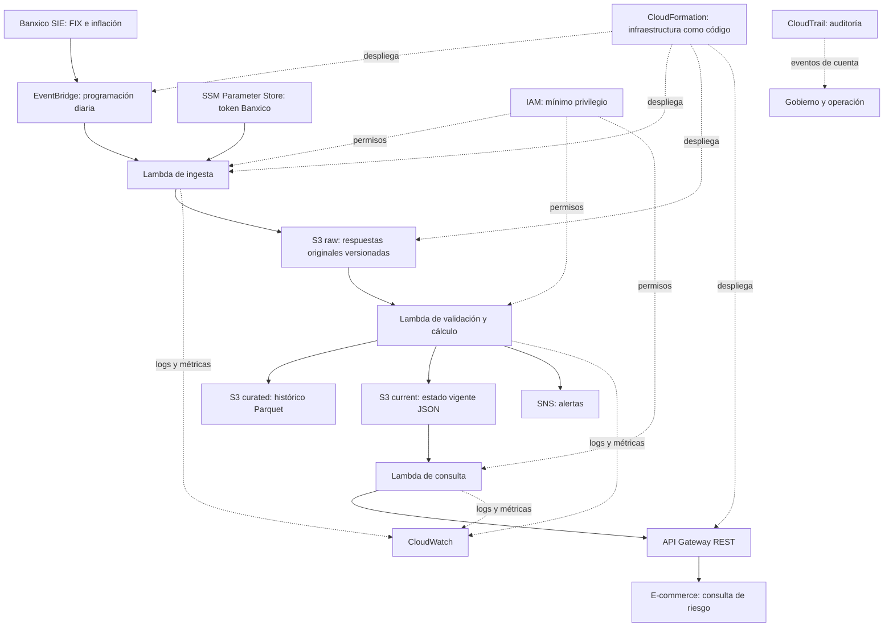

# SOW: Sistema de blindaje cambiario y precio dinámico

**Consultora:** SOFTCOM DATA ENGINEERING SOLUTIONS  
**Cliente:** ImportaTech Mexico  
**Respuesta al RFP del:** 05/10/2026  
**Versión:** 3.0  
**Fecha de versión:** 20/10/2026  
**Plazo:** 8 semanas naturales desde la firma  
**Presupuesto de desarrollo:** $345,000 MXN  
**Costo operativo objetivo:** hasta $4,500 MXN mensuales, sujeto a validación de precios, cuotas y elegibilidad de AWS Free Tier.

## 1\. Resumen ejecutivo

Implementaremos un pipeline de datos serverless que capture el tipo de cambio FIX y la serie de inflación del SIE de Banxico, conserve las respuestas originales, valide y procese los datos, calcule indicadores de volatilidad y riesgo, emita alertas y publique el estado vigente para consumo del e-commerce. La solución prioriza servicios administrados básicos de AWS, infraestructura como código y costos controlados.

La API consulta el último estado publicado por el pipeline. No se interpreta “tiempo real” como una cotización intradía, porque el FIX es un indicador oficial de publicación diaria. El sistema no realizará operaciones de cobertura financiera ni cambios en el frontend o en las pasarelas de pago.

## 2\. Objetivos y trazabilidad con el RFP

|Necesidad|Solución propuesta|Criterio de aceptación|
|-|-|-|
|N1. Ingesta automatizada de FIX e inflación|EventBridge + Lambda + API SIE de Banxico; payload original en S3|Ingesta verificada en al menos 99.5% de los días hábiles en el periodo de prueba acordado. Se documentan días sin publicación y fallos del proveedor.|
|N2. Detección de saltos críticos|Lambda de validación y cálculo + SNS|Alerta de anomalía entregada en menos de 5 minutos desde que el indicador oficial queda disponible para el pipeline.|
|N3. Consulta de riesgo|API Gateway + Lambda que lee el estado vigente en S3|Prueba de latencia p95 y p99; objetivo p99 inferior a 250 ms bajo una carga acordada. Se documenta el tamaño de muestra y el entorno de prueba.|
|N4. Protección del margen|Reglas con costo USD, FIX, precio MXN y margen objetivo; bandera para ajustar precio o pausar promociones|Reducir en 50% las ventas con margen negativo atribuibles al desbalance cambiario frente al trimestre anterior, una vez acordadas la definición, línea base y método de medición con Finanzas.|

La meta N4 depende de la integración y calidad del catálogo, de la aplicación efectiva de las recomendaciones por el e-commerce y de la disponibilidad de una línea base comparable. El sistema recomienda/expone el estado; no modifica precios automáticamente salvo aprobación explícita de una ampliación de alcance.

## 3\. Alcance

### 3.1 Incluido

* Infraestructura mínima en AWS desplegada con CloudFormation.
* Programación de ingesta mediante Amazon EventBridge.
* Lambda de ingesta del tipo de cambio FIX y la serie de inflación del SIE de Banxico.
* Almacenamiento de payloads originales en Amazon S3 con versionado habilitado.
* Reintentos con espera incremental, control de duplicados e identificación de días sin publicación.
* Validaciones de calidad: campos requeridos, nulos, formato, rangos plausibles, duplicados, fechas y consistencia básica.
* Cálculo parametrizable de variaciones, ventana móvil, volatilidad y banderas de riesgo.
* Histórico limpio en Parquet en S3 y objeto JSON pequeño con el estado vigente.
* Lectura de una exportación del catálogo desde SQL Server: SKU, costo base USD, precio MXN, stock y margen objetivo por categoría.
* API REST mínima para consultar estado vigente y recomendaciones de precio/promoción.
* Alertas SNS ante anomalías críticas y fallos persistentes de ingesta/procesamiento.
* Logs, métricas y alarmas de operación en CloudWatch.
* IAM de mínimo privilegio, token en SSM Parameter Store como `SecureString`, y auditoría de actividad AWS mediante CloudTrail.
* Pruebas, manual técnico, documentación de API y sesión de transferencia de conocimiento.

### 3.2 Fuera de alcance

* Rediseño, desarrollo visual o remaquetación del e-commerce.
* Migración, modificación o administración de SQL Server.
* Conexión directa permanente con SQL Server si el cliente no habilita un mecanismo seguro de extracción; se utilizará una exportación periódica acordada.
* Renegociación de contratos, automatización de pagos o transferencias a proveedores.
* Coberturas financieras, futuros, derivados o compra/venta especulativa de divisas.
* Administración o integración de Stripe, Mercado Pago, PayPal u otras pasarelas.
* Cambios automáticos de precios en producción: el entregable expone señales y recomendaciones; la aplicación automática requiere autorización y contrato de interfaz con el equipo de e-commerce.
* Alta disponibilidad multi-región, arquitectura multi-AZ o componentes que no sean necesarios para los criterios del RFP.

## 4\. Arquitectura propuesta

**Flujo principal**

1. EventBridge programa la ejecución diaria alineada con la publicación del FIX. La ingesta también podrá ejecutarse inmediatamente tras la publicación si el mecanismo de programación y la disponibilidad del dato lo permiten.
2. Lambda consulta el SIE de Banxico usando el token almacenado en SSM Parameter Store.
3. La respuesta original se almacena en S3 (`raw/`) con fecha, serie, hora de captura y metadatos de ejecución. El versionado de S3 protege frente a sobrescrituras accidentales.
4. La Lambda de procesamiento valida los datos, deduplica por serie/fecha, calcula indicadores y genera salidas. Los fallos no sobrescriben un último estado válido.
5. El histórico curado se escribe en Parquet en S3 (`curated/`); el estado de riesgo más reciente se escribe como JSON pequeño en S3 (`current/`).
6. La Lambda publica alertas mediante SNS cuando detecta anomalías o fallos que superan los reintentos.
7. API Gateway expone una API mínima; la Lambda de consulta lee el objeto `current/` y devuelve el último estado publicado.
8. CloudWatch registra logs, métricas y alarmas. CloudTrail permite auditar actividad de la cuenta y cambios de configuración. IAM separa los permisos por función.

**Decisión de almacenamiento:** se elige S3 para raw, histórico curado y estado vigente. La serie diaria no justifica una base de datos documental ni una base relacional dedicada. El endpoint no consulta Athena en línea, porque una consulta analítica síncrona no es adecuada para el objetivo de latencia. Si las pruebas demuestran que S3 no cumple el objetivo p99 de 250 ms, se evaluará una capa de estado de baja latencia como cambio controlado y con estimación de costo.

**Servicios propuestos y justificación**

|Servicio|Motivo de inclusión|
|-|-|
|EventBridge|Programa la ingesta diaria sin servidor permanente.|
|Lambda|Ejecuta tareas pequeñas de ingesta, cálculo y consulta sin mantener contenedores activos.|
|S3|Conserva originales versionados, histórico Parquet y el estado vigente de bajo volumen.|
|API Gateway|Publica el endpoint solicitado con controles de acceso y métricas.|
|SNS|Distribuye alertas de anomalías y fallos.|
|CloudWatch|Permite observar errores, duración, éxito de ingesta y latencia.|
|SSM Parameter Store|Guarda el token de Banxico como parámetro cifrado sin agregar Secrets Manager al diseño.|
|IAM|Aplica mínimo privilegio por función y recurso.|
|CloudTrail|Mantiene trazabilidad de actividad y cambios de configuración.|
|CloudFormation|Despliega la infraestructura de forma repetible y versionada.|

No se incluye una VPC dedicada para las Lambdas que solo consumen la API pública de Banxico; así se evita introducir un NAT Gateway sin necesidad demostrada. El costo real depende de región, volumen, solicitudes, retención y elegibilidad de la cuenta. Antes de producción se comprobará con AWS Pricing Calculator y una prueba de consumo; no se garantiza costo cero ni que todos los servicios sean gratuitos de forma permanente.

**Diagrama de arquitectura**



El diagrama representa el flujo lógico propuesto; los recursos definitivos, las políticas IAM y la configuración de auditoría se detallarán en la infraestructura como código.


## 5\. Datos, reglas y calidad

### Fuentes

* **Banxico SIE:** serie FIX y serie de inflación, con token proporcionado por el cliente.
* **Catálogo SQL Server:** exportación periódica con SKU, costo USD, precio vigente MXN, stock y margen objetivo por categoría.

### Reglas iniciales

* El umbral de anomalía lo aprueba el área de Finanzas/Precios durante la semana 1.
* Como hipótesis de trabajo se evaluará una desviación superior a dos desviaciones estándar sobre una ventana móvil de siete observaciones; no se activa como regla productiva hasta la aprobación del cliente.
* Se conservarán tanto el valor publicado como la fecha del indicador y la fecha/hora de ingesta.
* Si Banxico no publica el indicador en un día inhábil o no hay una observación nueva, se marca el estado como “sin nueva publicación”; no se inventa ni se extrapola una cotización.
* En caso de caída del proveedor, se ejecutarán reintentos con espera incremental y luego se emitirá alerta. El pipeline retomará el histórico faltante mediante backfill sin alterar los originales.

### Controles de calidad

* Campos y fechas obligatorios presentes.
* Valores numéricos parseables y dentro de rangos configurables.
* Duplicados por serie y fecha identificados y tratados idempotentemente.
* Detección de cambios inesperados en la estructura del payload.
* Coherencia entre la fecha del indicador y el periodo esperado.
* Validación de columnas y tipos del catálogo; SKU duplicados o costos/precios nulos se ponen en cuarentena y generan reporte.
* Conteos de registros de entrada, aceptados, rechazados y procesados registrados en logs/métricas.

Los límites numéricos y el manejo comercial de registros inválidos se acuerdan con ImportaTech antes de activar reglas productivas.

## 6\. API propuesta

### `GET /v1/risk/current`

Devuelve el estado vigente calculado con la última publicación disponible.

Ejemplo de respuesta:

```json
{
  "indicator_date": "2026-10-20",
  "ingested_at": "2026-10-20T18:35:00Z",
  "fx_fix_mxn_per_usd": 18.25,
  "inflation_value": null,
  "risk_status": "NORMAL",
  "anomaly": false,
  "catalog_evaluation": "PENDING_CATALOG_EXPORT",
  "promotion_action": "NO_CHANGE",
  "rule_version": "pending-client-approval"
}
```

Los valores del ejemplo son ilustrativos, no cotizaciones reales. La serie de inflación puede tener una periodicidad distinta a la diaria; se devuelve su última observación disponible y su fecha propia, no se trata como una observación diaria.

### `GET /v1/health`

Devuelve estado operativo básico sin exponer costos, márgenes, tokens ni datos confidenciales.

La API no devuelve métricas internas de margen por SKU a usuarios públicos. El acceso de consumo y el acceso administrativo se limitan por política de autorización acordada con el cliente.

## 7\. Entregables y criterios de aceptación

|ID|Entregable|Criterio de aceptación|
|-|-|-|
|E1|Infraestructura como código y arquitectura|Stack de CloudFormation desplegable; diagrama actualizado; IAM de mínimo privilegio revisado.|
|E2|Pipeline de ingesta y raw|FIX e inflación configurados; payload original guardado en S3 versionado; ejecución idempotente; evidencia de éxito y reintentos.|
|E3|Procesamiento, calidad e histórico|Validaciones documentadas; histórico Parquet; estado vigente JSON; pruebas de duplicados, nulos, rango y reproceso.|
|E4|API y alertas|Endpoint documentado; prueba de latencia p99 objetivo <250 ms; evidencia de alerta SNS <5 min en prueba controlada.|
|E5|Producción y transferencia|Manual técnico, guía de recuperación/backfill, ejemplos de API, checklist de seguridad y sesión de handoff completada.|

## 8\. Cronograma de ocho semanas

|Semana|Actividades|Hito / evidencia|
|-|-|-|
|1|Kickoff, aclaraciones del RFP, aprobación de regla de anomalía, definición de línea base N4, acceso/token y contrato del catálogo|**Hito 1:** alcance, reglas y arquitectura aprobados|
|2|CloudFormation inicial, IAM, S3, Parameter Store, CloudWatch y repositorio|Revisión de infraestructura y permisos|
|3|Lambda de ingesta FIX e inflación, EventBridge, persistencia raw, idempotencia|**Hito 2:** ingesta y raw demostrables|
|4|Reintentos, días sin publicación, backfill, pruebas de payload y controles de calidad|Informe de pruebas de resiliencia/calidad|
|5|Cálculos de variación/volatilidad, integración de exportación de catálogo, estado vigente|**Hito 3:** procesamiento y datos curados|
|6|API Gateway + Lambda de consulta, SNS, documentación de contratos|**Hito 4:** API y alertas demostrables|
|7|Pruebas de latencia, seguridad, fallos del proveedor, revisión de costos y ajustes|Reporte de aceptación y remediaciones|
|8|Despliegue de producción, manuales, capacitación, aceptación y cierre|**Hito 5:** go-live y transferencia|

Las fechas calendario se asignan al firmar el contrato. La disponibilidad de accesos, token, exportación de catálogo y aprobación de reglas es necesaria para mantener el plazo.

## 9\. Equipo y responsabilidades

La experiencia individual específica no está documentada en los insumos disponibles; los siguientes renglones describen la experiencia funcional requerida para el proyecto y deberán sustituirse o validarse con antecedentes reales del equipo antes de enviar la propuesta.

* **Ing. Victoria Monserrat Muñoz San Agustin — Project Manager \& Data Architect:** lidera arquitectura, planificación, gobierno, seguridad IAM y aceptación técnica. Experiencia funcional requerida: diseño de pipelines, coordinación de entregas y decisiones de arquitectura cloud.
* **Ing. Santiago Velasco Garcia — Data Engineer, ingesta:** implementa API de Banxico, programación, raw e idempotencia. Experiencia funcional requerida: Python, REST APIs, manejo de errores y almacenamiento de datos.
* **Ing. Mauricio Acosta Díaz — Data Engineer, procesamiento:** implementa validaciones, cálculos de volatilidad, anomalías y datos curados. Experiencia funcional requerida: ETL, calidad de datos y análisis de series temporales.
* **Ing. José Rodrigo López López — Data Engineer, calidad/modelado:** define contratos de datos, esquema de histórico, exportación de catálogo y pruebas de consistencia. Experiencia funcional requerida: modelado de datos, SQL y optimización de almacenamiento.
* **Ing. Héctor Guerrero Gutiérrez — Backend/API:** implementa API Gateway, Lambda de consulta, autorización y contrato de respuesta. Experiencia funcional requerida: APIs REST, integración y pruebas de latencia.

No se atribuyen años de experiencia, certificaciones ni proyectos previos porque esos datos no aparecen en la documentación recibida.

## 10\. Supuestos y dependencias del cliente

* ImportaTech entregará token de Banxico y autorizará su uso en SSM Parameter Store.
* ImportaTech proporcionará una exportación periódica y segura del catálogo SQL Server con las columnas acordadas. La frecuencia, formato y responsable se definirán en semana 1.
* Finanzas/Precios aprobará el umbral de anomalía, reglas de margen, tratamiento de promociones y línea base de N4.
* El equipo del e-commerce documentará cómo consumirá la API y decidirá cómo aplicar la recomendación; no se modifica el frontend ni se automatizan cambios de precio en este alcance.
* El cliente designará responsables para validar pruebas, alertas y aceptación.
* La región AWS, cuenta, retención y cuotas se confirmarán durante el kickoff.

## 11\. Matriz de riesgos

|Riesgo|Probabilidad / impacto|Mitigación y contingencia|
|-|-|-|
|Caída o retraso de Banxico|Media / Alto|Reintentos con espera incremental; no sobrescribir estado válido; SNS tras agotar reintentos; backfill al recuperar el proveedor.|
|Cambio de estructura del payload|Media / Alto|Conservar raw versionado; validar esquema; poner registro en cuarentena, alertar y reprocesar tras ajustar el parser.|
|Día sin publicación|Alta / Medio|Calendario de días hábiles y estado explícito “sin nueva publicación”; no tratar ausencia de dato como anomalía cambiaria.|
|Catálogo incompleto o desactualizado|Media / Alto|Validación de columnas, frescura y SKU; reporte de registros rechazados; bloquear recomendaciones por SKU sin datos confiables.|
|Latencia API superior a 250 ms|Media / Alto|Leer un objeto JSON pequeño; medir p95/p99; optimizar inicialización; si no cumple, evaluar almacenamiento de estado de baja latencia con aprobación de costo/cambio.|
|Regla de anomalía no aprobada|Media / Alto|No activar umbral provisional en producción; aprobación formal de Finanzas/Precios en semana 1.|
|Exposición de costos, márgenes o token|Baja / Alto|IAM mínimo privilegio, `SecureString`, no registrar secretos, separar respuesta pública de datos internos y revisar permisos.|
|Costos AWS por encima del objetivo|Media / Medio|Alertas de presupuesto/consumo cuando estén disponibles; revisar uso y retención semanal; validar estimación con calculadora oficial antes de producción.|
|Falta de cumplimiento de N4 por adopción|Media / Alto|Acordar línea base y responsabilidades; medir resultados por periodo; documentar que la recomendación técnica no garantiza por sí sola el resultado comercial.|

## 12\. Seguridad, gobierno y operación

* Token de Banxico en SSM Parameter Store `SecureString`; nunca en código, README, logs ni repositorio.
* Roles IAM separados para ingesta, procesamiento y consulta, con permisos limitados a recursos necesarios.
* S3 Block Public Access habilitado; cifrado en reposo y versionado para `raw/`.
* Transporte HTTPS para llamadas externas y API.
* CloudTrail para auditoría de actividad AWS; CloudWatch para observabilidad operacional.
* Retención y acceso a datos definidos con el cliente; las métricas de margen y costo no se exponen al público.
* CloudFormation como única herramienta IaC; cambios revisados en Git.
* Procedimiento de backfill documentado y probado antes del go-live.

## 13\. Propuesta económica

### Honorarios de desarrollo

|Concepto|Horas|Tarifa MXN/h|Subtotal MXN|
|-|-:|-:|-:|
|Arquitectura, gestión e infraestructura como código|40|$1,500|$60,000|
|Ingeniería de datos: ingesta, calidad, procesamiento e histórico|120|$1,300|$156,000|
|API, integración, pruebas y transferencia técnica|90|$1,300|$117,000|
|Colchón de imprevistos / aseguramiento QA|—|—|$12,000|
|**Total de honorarios de desarrollo**|**250**||**$345,000**|

El colchón de QA es una provisión monetaria y no suma horas adicionales. Las 250 horas del presupuesto coinciden con las 250 horas del cronograma por hitos.

### Costo operativo mensual estimado

La estimación preliminar se elaboró con AWS Pricing Calculator para la región **México (Central)**, usando los resultados observados en la calculadora y un escenario de bajo volumen. Se consideran 100,000 solicitudes mensuales a la API y una provisión del 16% de IVA para planeación.

#### Desglose de costos

| Componente | Configuración de referencia | Costo mensual estimado (USD) |
|---|---|---:|
| Amazon S3 | S3 Standard; 5 GB, 1,000 solicitudes PUT y 10,000 solicitudes GET; transferencia configurada en la calculadora | $0.5800 |
| AWS Lambda | 100,000 solicitudes, 256 MB y 500 ms según la configuración registrada; validar que cubra las tres funciones de la arquitectura | $0.0000* |
| Amazon EventBridge | Resultado de la configuración registrada; confirmar que corresponde a EventBridge Scheduler para la programación diaria | $0.0000* |
| Amazon API Gateway REST | 100,000 solicitudes mensuales, sin caché dedicada | $0.3675 |
| Amazon SNS + CloudWatch + CloudTrail | Rango combinado estimado para notificaciones, logs, métricas, alarmas y auditoría | $0.0000–$1.0500 |
| AWS Systems Manager Parameter Store | Un parámetro estándar para el token de Banxico | $0.0000* |
| **Total mensual estimado antes de IVA** | **Suma de los servicios considerados** | **$0.9475–$1.9975** |
| Provisión de IVA (16%) | Total antes de IVA × 0.16 | $0.1516–$0.3196 |
| **Total mensual estimado con IVA** | **Total antes de IVA × 1.16** | **$1.0991–$2.3171** |

\* Los importes de $0.00 corresponden a los resultados mostrados por la calculadora con la configuración y los beneficios gratuitos aplicados en ese momento. No garantizan que el consumo productivo sea gratuito; deben validarse los límites, la elegibilidad de la cuenta y el número real de ejecuciones.

#### Supuestos y consideraciones

- **Región:** AWS México (Central), conforme a la selección mostrada en la calculadora.
- **Solicitudes de API:** 100,000 al mes para el endpoint REST.
- **Almacenamiento:** 5 GB en S3 Standard. Este valor representa el volumen introducido en la calculadora; no demuestra por sí solo que el crecimiento de datos y las versiones anteriores durante 12 meses estén completamente cubiertos. El volumen debe ajustarse si los datos acumulados y las versiones retenidas superan ese supuesto.
- **Transferencia de datos:** se conserva la configuración introducida en la calculadora. La transferencia de salida de S3 y la transferencia de respuestas de API Gateway deben evaluarse por separado para evitar omisiones o doble conteo.
- **Cobertura de Lambda y EventBridge:** antes de producción, confirmar que se hayan modelado las tres funciones previstas y la modalidad de programación diaria realmente desplegada.
- **Beneficios gratuitos:** Lambda, EventBridge y Parameter Store aparecen en $0.00 en la configuración registrada; los cargos reales pueden cambiar según la elegibilidad, los límites gratuitos y el consumo. SNS está incluido en el rango combinado con CloudWatch y CloudTrail y no debe sumarse de nuevo.
- **Impuestos:** se utiliza una provisión del 16% para planificación. La factura final depende del tratamiento fiscal aplicable a cada concepto.

Los importes son estimaciones basadas en los resultados registrados en AWS Pricing Calculator y no constituyen una garantía de facturación. Antes de producción se validarán las tarifas efectivas, la retención, el versionado de S3, la transferencia y la configuración de observabilidad y auditoría.

#### Control de costos

El objetivo operativo del proyecto es mantener el gasto por debajo de **$4,500 MXN mensuales**, sujeto a la validación de precios, cuotas, impuestos y condiciones de la cuenta AWS. Se revisará periódicamente el consumo de almacenamiento, solicitudes, transferencia, logs y métricas. Si la estimación o el consumo observado supera el objetivo, se evaluarán ajustes de configuración y arquitectura mediante el procedimiento de control de cambios.

La estimación puede actualizarse en [AWS Pricing Calculator](https://calculator.aws/) cuando cambien la región, el volumen de solicitudes, la retención o los servicios desplegados.

## 14\. Control de cambios, aceptación y pagos

Los cambios de alcance se registran en Git y se aprueban por escrito cuando afecten presupuesto, fechas, seguridad o criterios de aceptación. La coordinación será semanal, con demostración al cierre de cada hito; se utilizará un solo sistema de seguimiento acordado, sin exigir Jira ni un ambiente de staging separado.

Los pagos se vinculan a los hitos consistentes del proyecto:

* **20%** a la firma y aprobación del alcance/arquitectura (Hito 1).
* **40%** al aceptar procesamiento, calidad y datos curados (Hito 3).
* **40%** al aceptar API, alertas, puesta en producción y transferencia (Hito 5).

La aceptación se documenta contra los criterios de la sección 7. Los cambios de umbral o reglas de negocio después de su aprobación se gestionan mediante control de cambios.

## 15\. Aprobación

|Por ImportaTech Mexico|Por SOFTCOM DATA ENGINEERING SOLUTIONS|
|-|-|
|Nombre: \_\_\_\_\_\_\_\_\_\_\_\_\_\_\_\_\_\_\_\_|Nombre: \_\_\_\_\_\_\_\_\_\_\_\_\_\_\_\_\_\_\_\_|
|Cargo: \_\_\_\_\_\_\_\_\_\_\_\_\_\_\_\_\_\_\_\_\_|Cargo: \_\_\_\_\_\_\_\_\_\_\_\_\_\_\_\_\_\_\_\_\_|
|Firma/fecha: \_\_\_\_\_\_\_\_\_\_\_\_\_\_\_|Firma/fecha: \_\_\_\_\_\_\_\_\_\_\_\_\_\_\_|


