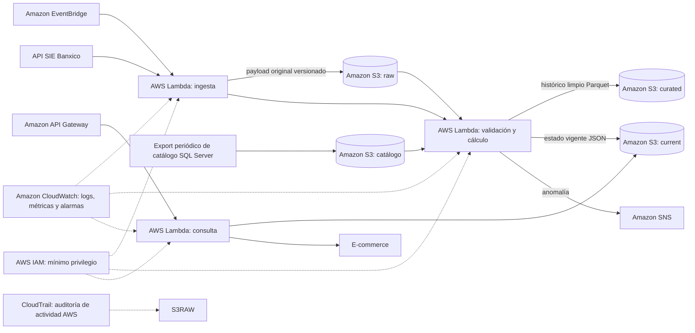

# Sistema de blindaje cambiario y precio dinámico

Pipeline de ingeniería de datos para ImportaTech Mexico que automatiza la captura del tipo de cambio FIX y la inflación publicados por Banxico, conserva los datos de origen, calcula indicadores de riesgo y expone el estado vigente para que el e-commerce evalúe ajustes de precio o congelamiento de promociones.

## Objetivos

- Ingerir los indicadores del SIE de Banxico de forma automatizada y verificable.
- Detectar anomalías cambiarias y emitir alertas en menos de cinco minutos desde la publicación del indicador.
- Consultar el estado de riesgo mediante una API con objetivo de latencia inferior a 250 ms.
- Reducir en 50% las ventas con margen negativo atribuibles al desbalance cambiario frente al trimestre anterior, sujeto a acordar y medir la línea base.

## Arquitectura



> El diagrama es conceptual. El despliegue debe validar cuotas, precios y elegibilidad de la cuenta AWS. No se asume que todos los servicios mantengan costo cero en cualquier cuenta o volumen.

## Estructura del repositorio

```text
.
├── README.md
├── rfp.md
├── sow.md
└── docs/
    └── arquitectura/
        └── arquitectura.mmd
```

## Documentos

- [RFP](rfp.md): necesidades, restricciones y criterios del cliente.
- [SOW](sow.md): alcance, entregables, cronograma, equipo, riesgos y propuesta económica.
- [Diagrama de arquitectura](docs/arquitectura/arquitectura.mmd): flujo de datos, seguridad y auditoría.

## Tecnologías propuestas

- Amazon EventBridge para la programación diaria.
- AWS Lambda (Python y biblioteca estándar) para ingesta, validación, cálculo y API.
- Amazon S3 con versionado para datos crudos, datos curados y estado vigente.
- Amazon API Gateway para exponer el endpoint de consulta.
- Amazon SNS para alertas.
- Amazon CloudWatch para logs, métricas y alarmas.
- AWS Systems Manager Parameter Store (`SecureString`) para el token de Banxico.
- AWS IAM y CloudTrail para control de acceso y auditoría.
- AWS CloudFormation como única herramienta de infraestructura como código.

## Decisiones de diseño

- El dato crudo se conserva en S3 con versionado para reprocesar la historia sin mantener una base documental activa.
- Una Lambda es suficiente para una serie diaria pequeña; no se propone ECS/Fargate.
- El histórico se guarda en Parquet en S3. La API consulta un objeto JSON pequeño con el estado vigente; no ejecuta consultas analíticas síncronas.
- El catálogo de SQL Server se extrae mediante exportación periódica acordada con el cliente. El proyecto no migra ni modifica SQL Server.
- El tipo de cambio FIX es diario; la API devuelve el último estado publicado, no una cotización intradía.
- Los umbrales de anomalía deben aprobarse con Finanzas/Precios. La regla de dos desviaciones estándar sobre una ventana móvil de siete observaciones es solo una propuesta inicial para validación.

## Cómo ejecutar el trabajo

1. Revisar `rfp.md` y acordar las aclaraciones pendientes.
2. Aprobar los supuestos y criterios de aceptación de `sow.md`.
3. Configurar el token de Banxico en Parameter Store y los permisos IAM mínimos.
4. Desplegar infraestructura con CloudFormation.
5. Ejecutar pruebas de ingesta, calidad, alertas, seguridad y latencia.
6. Hacer el traspaso al equipo de ImportaTech con manuales y ejemplos de respuesta de la API.
